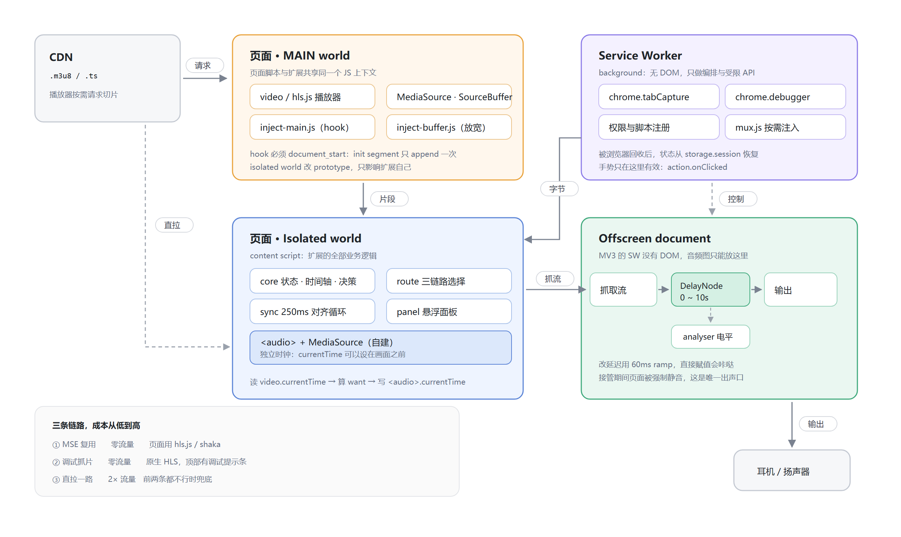

# 蓝牙耳机看剧总慢半拍：我把声音往前挪了一点

看剧时嘴已经闭上了，声音才出来。蓝牙耳机延迟 100~300ms，投屏更久。

我写了个扩展：接管当前标签页的声音，往前或往后挪，把这点错位对回来。这篇不讲 API，只讲它的骨架——**声音从哪来、怎么对齐、错了怎么办**。



*声音从三条路进来，经过四道手，最后只有一套对齐逻辑。*

## 一、先看全貌：声音要过四道手

浏览器给扩展的不是一个环境，是四个，各干各的活：

- **页面自己的环境**：唯一改得动页面播放器的地方。改得晚也不行，必须赶在页面脚本之前跑。
- **扩展的隔离环境**：大部分代码住这，能调浏览器接口，但改不到页面的对象。
- **后台**：只有这里点图标才算「用户同意」，所以接管只能从这发起。
- **一个隐藏的空白页**：播放声音要用的音频环境，后台里没有。

所以这个项目的目录结构不是我设计的，是这四个环境各自能干什么划出来的。

比如「接管」这一步，两段代码就不在同一个文件里：

```js
// 后台：只有点击图标这一下，才算用户同意，才拿得到流 id
const streamId = await chrome.tabCapture.getMediaStreamId({ targetTabId: tabId });

// 隐藏页：把这条流接成音频图，延迟之后再送回扬声器
const stream = await navigator.mediaDevices.getUserMedia({
  audio: { mandatory: { chromeMediaSource: 'tab', chromeMediaSourceId: streamId } },
  video: false
});

const ctx = new AudioContext({ latencyHint: 'interactive' });  // 隐藏页里新建
const delay = ctx.createDelay(10.5);
ctx.createMediaStreamSource(stream).connect(delay).connect(ctx.destination);
```

环境定完，第一个问题就是：声音从哪拿？

## 二、声音从哪来：三条路，最后都变成一个 audio

一共三条路，成本差一倍：

| 走哪条 | 怎么拿 | 额外流量 |
|---|---|---|
| ① 复制 | 页面用 hls.js 播放时，复制它已经下载的音频片段 | 0 |
| ② 拆包 | 页面是原生 HLS 时，用调试协议把切片取回来，重新打包 | 0 |
| ③ 重拉 | 自己把同一个流再下一遍 | **翻倍** |

为什么不只留一条？因为实时的声音里没有「未来」——想提前，只能提前拿到画面还没播到的那段音频。而不同站点的播放方式不一样，只能分开处理。

第一条路是这么拿的——播放器往缓冲区塞音频时，顺手复制一份出来：

```js
// sb 就是页面播放器建的那个 SourceBuffer，这段跑在页面自己的环境里
const origAppend = sb.appendBuffer.bind(sb);   // 先留一份原来的
sb.appendBuffer = function (data) {
  // 必须复制：appendBuffer 会把传进去的数组清空，晚一步拿到的就是空壳
  const copy = data.slice(0);
  window.postMessage({ __ads: true, type: 'chunk', data: copy }, '*', [copy]);
  return origAppend(data);   // 页面自己的播放完全不受影响
};
```

但三条路只在**取数据**这一段不同。拿到之后，统一变成一条只有声音的 `audio`（就是页面里放声音的那个标签）——它有自己的进度条，所以可以被摆到画面前面。

这一步是整个架构里最省事的地方：对齐逻辑只有一份，以后加第四条路也不用改它。

顺带说一句：③ 只在完全抓不到时兜底。因为它从 0 秒开始播，在 5 分钟处根本追不回来，运行中切过去只会更糟。

路的问题解决完，马上撞上第二个问题：这两个进度条，对不上。

## 三、两个进度条对不上，差的是一个固定数

页面有自己的进度，我们那条 `audio` 也有一个。两边播放速度一样，差的是一个**固定值**。

实测 1.6 秒。不补这一下，位置看着对齐，内容整体晚一句台词。

这个值不能写死。播放器如果在第 6 分钟才启用这个功能，切片是从 0 重新计时的，差值直接变成 −460 秒。

所以让它自己量：只在两边都往前走了才取一次样本，攒 9 次取中间值，太散了就不要。这样不管从第几秒启用，它都能自己收敛。

量法就这几行：

```js
const da = audioEnd - lastAudioEnd;      // 声音这边往前走了多少
const dv = videoEnd - lastVideoEnd;      // 画面这边往前走了多少

if (da < 0.05 || dv < 0.05) return;      // 只有一边动了：量出来的是「谁先下载」
if (Math.abs(da - dv) > 0.3) return;     // 一边跨了好几片，这一拍不可比

const sample = audioEnd - videoEnd;      // 两条时间轴的差值
samples.push(sample);
if (samples.length > 9) samples.shift(); // 只留最近 9 次

// 取中位数而不是平均值：偶尔一片迟到，平均值会被带跑
const sorted = samples.slice().sort((a, b) => a - b);
offset = sorted[Math.floor(sorted.length / 2)];
```

这里踩过最深的坑：我一开始把「超过 10 秒」当异常丢掉。结果 −460 这种正常样本永远进不来，声音死死停在片头，面板还写着「音频慢 460 秒」——怎么拖都没用。把上限放到 1 小时才对。

知道差多少，下一步才是动手。

## 四、知道差多少之后：先判断，再动手

每 250 毫秒算一次差多少，然后照这张表办：

| 情况 | 做什么 |
|---|---|
| 差超过 0.35 秒 | 直接把位置挪过去 |
| 差得不多 | 把播放速度调到 0.9~1.1 倍，慢慢追 |
| 目标位置还没数据 | 先静音，等数据到了再对齐 |

中间那档用的是变速不变调，短时间听不出来；但范围必须夹住，再大就是明显的快放慢放。

比阈值更重要的是：**判断和执行是分开的**。判断那一层只回答「继续等、降档、还是换条路」，不碰播放器；执行那一层才真的去暂停、跳转、改速度。

```js
// 判断：只吃状态、只返回结论，从头到尾没碰过播放器
function decideSilence(x) {
  if (x.adGrace || x.feeding) return 'wait';         // 广告中 / 数据还在来
  if (x.silentMs > x.silentLimit) return 'degrade';  // 超预算：换条路（预算见下一节）
  if (x.silentMs > 2000) return 'downgrade';         // 先把提前量降下来
  return 'wait';
}
```

执行那一层（`captureTick`）拿到 `'downgrade'` 就把提前量降到缓冲撑得住的位置，拿到 `'degrade'` 就退出增强模式——判断和执行之间只传一个字符串。

好处很实在：这套判断能单独测（项目里 22 组 154 条断言，专门有一组在验它），改阈值不会把播放器改坏。

到这儿，顺利的情况都讲完了。但实际用起来，失败才是常态。

## 五、动手也可能失败，所以退路要提前留

退路有三层，顺序不能反：先**降档**（少提前一点，让声音先出来），还不行就**降级**（退出增强模式，回到只能延后的普通模式），最后才考虑**换第三条路**（代价是流量翻倍）。

顺序反了会很贵——能用降档解决的，不该直接跳到翻倍流量。

还有两件必须提前想的事：

- **等多久不能写死**。第二条路的数据来自播放器请求，播放器自己在预缓冲时，我们什么也抓不到。固定 8 秒会把它冤杀，所以按画面剩余缓冲放宽，最多等 20 秒。
- **浏览器会来捣乱**。一进全屏，调试连接会被踢掉；后台闲置会被回收；消息发出去也不保证到达。这三件事都得有预案，不然表现就是「全屏后突然没声了」。

这些不是异常处理，是日常。

## 最后

骨架其实就三句话：

- 声音经过**四道手**，每道手只能干一件事；
- 来源有**三条路**，但出口只有一个 `audio`；
- 两边差**一个数**，量出来，再决定怎么动手。

想清楚这三件事，剩下的都是实现细节。

全程本地，零网络请求，MIT。仓库 `github.com/cxknotjj/web-audio-sync`，在线演示 `deerfect.me/web-audio-sync`。
